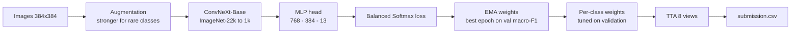

# White Blood Cell Classification: IMA205 Challenge 2026

Classification of white blood cells from blood-smear microscopy images into **13 cell types**, using a fine-tuned **ConvNeXt-Base** (ImageNet pre-trained) with strategies designed for **extreme class imbalance**. The ranking metric is the **macro-averaged F1 score**.

> Challenge: IMA205, Télécom Paris, 2026 (Kaggle). Only ImageNet pre-trained weights were allowed (no medical or blood-smear pre-training).

## Results

| Metric | Score |
|---|---|
| Validation macro-F1 (best epoch, EMA weights) | `0.781` |
| Validation macro-F1 after per-class weight tuning | `0.804` |
| Public leaderboard | `7` |
| Private leaderboard | `3` |

## Problem

- **Task**: predict the cell type of each image among 13 classes: SNE, LY, MO, EO, BA, VLY, BNE, MMY, MY, PMY, BL, PC, PLY.
- **Data**: 28,901 images, split into a labelled train/validation part (70%) and an unlabelled test part (30%).
- **Difficulty**: strong class imbalance (some classes such as PLY and PC are very rare) and visually close classes (e.g. SNE vs BNE, MY vs PMY). Macro-F1 gives each class the same weight, so rare classes matter as much as frequent ones.

## Approach



### Model
- Backbone: `convnext_base.fb_in22k_ft_in1k` from [`timm`](https://github.com/huggingface/pytorch-image-models), with stochastic depth (drop-path 0.2). ConvNeXt uses LayerNorm instead of BatchNorm, which suits the small batch size imposed by 384 px inputs.
- Head: `LayerNorm -> [Dropout -> Linear -> GELU] x 2 -> Dropout -> Linear(13)` with hidden sizes 768 and 384 (dropout 0.4).

### Handling class imbalance
- **Weighted sampler**: each image is drawn with weight `1 / count(class)^0.6`, with an extra boost for the rarest classes (PLY x6, PC x3, PMY x3).
- **Balanced Softmax loss**: `softmax(logits + log(class prior))` during training (Ren et al., 2020). Plain logits are used at inference.
- **Class-specific augmentation**: rare classes (PLY, PC, PMY) use a stronger augmentation pipeline (larger rotations, scale, colour jitter, more erasing).
- **MixUp / CutMix** (alpha 0.1) are disabled for batches containing PLY or PC, to avoid diluting the rarest classes.

### Training
- Optimizer AdamW (weight decay 1e-4) with the **OneCycle** schedule (max LR 8e-4, 10% warm-up, cosine decay).
- **Two-phase fine-tuning**: backbone frozen for 2 epochs (only the new head learns), then unfrozen with a learning rate 10x smaller than the head.
- **Gradient accumulation**: micro-batch 12 x 4 steps = effective batch 48. Mixed precision (AMP) and gradient clipping at 1.0.
- **EMA** of the weights (decay 0.999). The checkpoint with the best validation macro-F1 is kept.
- 50 epochs, stratified 80/20 train/validation split, seed 42.

### Post-training and inference
- **Per-class probability weights** searched on the validation set (grid 0.3 to 8) to maximise macro-F1.
- **Test-time augmentation**: 8 randomly augmented views per image (flips, rotation up to 45 degrees, light colour jitter). Softmax probabilities are averaged, then class weights are applied.

## Repository structure

```
.
├── wbc_classification.ipynb   # full pipeline (training, calibration, inference)
├── requirements.txt
└── README.md
```

The dataset and trained weights are not included (competition data, and the checkpoint exceeds GitHub's file size limit).

## How to run

**On Kaggle (recommended)**
1. Add the competition data to a notebook and enable a GPU.
2. Check the data path with `!ls /kaggle/input/` and update `CFG["data_dir"]` if needed.
3. Run all cells. The notebook produces `wbc_best.pth` and `submission.csv`.

**Locally**
```bash
pip install -r requirements.txt
# set CFG["data_dir"] to the folder containing train/, test/, train_metadata.csv and test_metadata.csv
jupyter notebook wbc_classification.ipynb
```
A GPU is strongly recommended (ConvNeXt-Base at 384 px). Section 14 of the notebook lets you skip training and run inference from an existing `wbc_best.pth`.

## Limitations and ideas for improvement

- The validation set is used both to select the best epoch and to tune the class weights, so the reported validation score is optimistic. Nested validation or a dedicated hold-out set would be cleaner.
- Rare classes have very few validation samples, so their per-class F1 is noisy and the tuned weights may overfit.
- The temperature `T` does not change the argmax of a single prediction; it only affects how probabilities are averaged across TTA views.
- The weighted sampler and Balanced Softmax both correct for imbalance, which may over-compensate. An ablation would clarify this.
- No systematic comparison with other backbones or sizes (e.g. ConvNeXt-Small, Swin, EfficientNet) was run.
- No hand-crafted features (shape, colour, texture) are combined with the deep features.

## References

- Liu et al., *A ConvNet for the 2020s* (ConvNeXt), CVPR 2022.
- Ren et al., *Balanced Meta-Softmax for Long-Tailed Visual Recognition*, NeurIPS 2020.
- Smith and Topin, *Super-Convergence: Very Fast Training of Neural Networks Using Large Learning Rates* (OneCycle), 2018.
- Zhang et al., *mixup: Beyond Empirical Risk Minimization*, ICLR 2018. Yun et al., *CutMix*, ICCV 2019.
- Ross Wightman, `timm` library.
